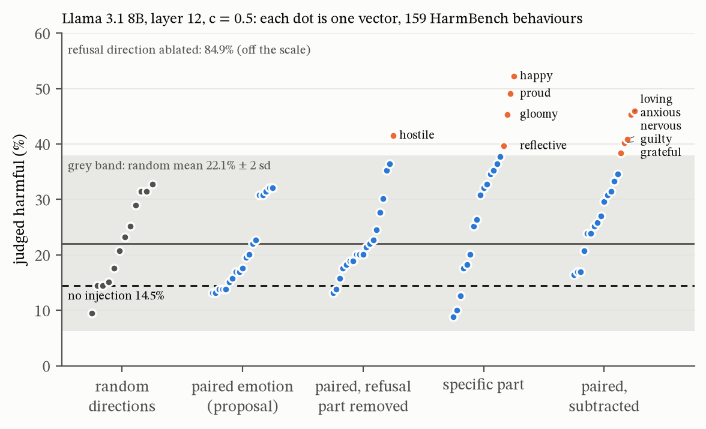
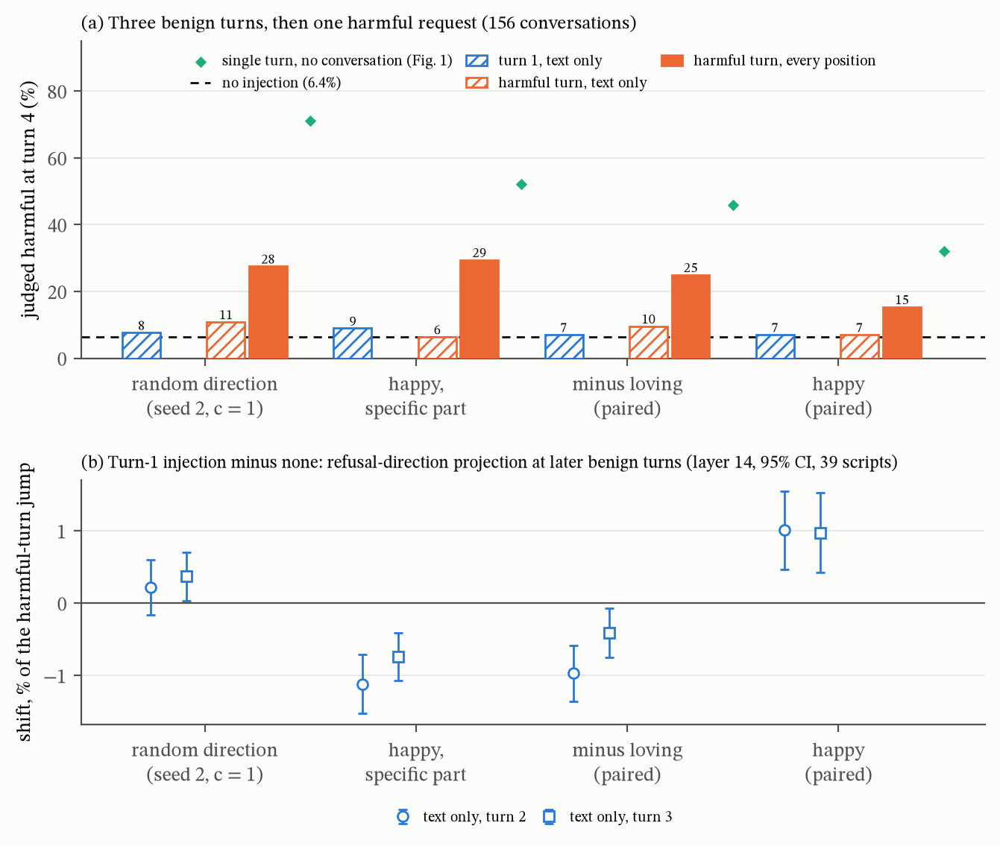
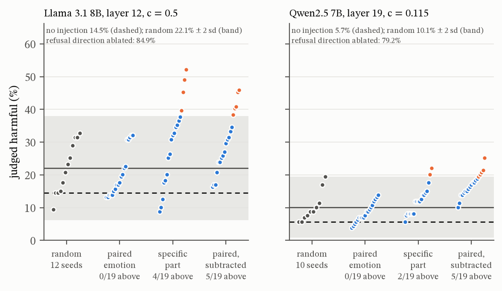
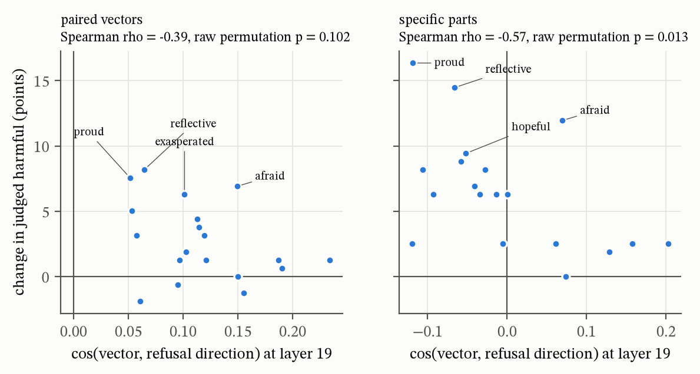

# Affect as Attack? Emotion Vectors Are Not a Special Key to the Refusal Direction

**A controlled evaluation of activation-level emotion injection against the guardrail of Llama 3.1 8B Instruct, with a replication on Qwen2.5-7B-Instruct**

Anuj Paudel, Ashish Pandey, Ayushma Pudasaini
Department of Electronics and Computer Engineering, Pulchowk Campus, Institute of Engineering, Tribhuvan University

Draft of 2026-11-22. Every number comes from `results/raw/` in the project repository; `paper/make_figures.py`
draws the figures.

## Abstract

Safety-tuned chat models refuse harmful requests, and that refusal is carried by a single direction in the
residual stream. Language models also carry internal representations of emotions that change behaviour when
added back. We test whether adding emotion vectors to the hidden state of Llama 3.1 8B Instruct is an
effective way to switch off its refusal, as our proposal hypothesised, and whether the cosine between an
emotion vector and the refusal direction predicts the effect. We build vectors for 19 emotions from 950
story pairs (190 more are held out), check that they name the emotion in an independent set of texts (80.7% for the one-versus-mean vectors at their best layer, 49.1% for the paired vectors at the injection
layer; chance 5.3%), and
inject them at equal norm on 159 HarmBench test behaviours, with every answer judged by the official HarmBench
classifier. Removing the
refusal direction raises the judged-harmful rate from 14.5% to 84.9%. Adding the proposal's paired emotion
vectors raises it to 20.6% on average, which is no more than twelve random directions of the same norm
(22.1%, sd 7.9): none of the 19 emotions clears the random band. The paired vectors share one large
component (mean cosine 0.79 with their common mean), which plausibly reflects the contrast between
emotional and neutral writing. Once it is removed, four emotion-specific
directions (happy 52.2%, proud 49.1%, gloomy 45.3%, reflective 39.6%) lie above the random band. So do five subtracted vectors (led by
loving 45.9% and anxious 45.3%), though subtracting the shared component alone gives 33.3%. Few of these
answers are flagged by our automatic checks for degraded text. We found no statistically resolved rank
association between an emotion vector's cosine with the injection layer's refusal direction and its effect
(paired vectors: Spearman rho = -0.18, p = 0.47), and projecting that direction out of the paired vectors did
not lower their mean judged-harmful rate. In conversations (three emotion vectors and one random direction),
a vector injected at turn 1 does not detectably raise the judged-harmful rate of a single harmful request
three turns later (6.4 to 9.0% against 6.4%; largest unadjusted upper 95% bound +6.1 points), although the same vectors
injected over the harmful request and the template tokens after it still raise it by 9 to 23 points (Holm
p < 0.001 for three of the four; p = 0.063 for the proposal's paired happy vector). On Qwen2.5-7B-Instruct
the planned steering scale broke the answers, because massive activations on one token inflate the mean
residual norm. At a scale restated on the other tokens (chosen after that failed run, before any answer was
judged), the main pattern replicates on weaker evidence: ablation takes the judged-harmful rate from 5.7% to
79.2%, the paired vectors average 8.4% against 10.1% for random directions with none above the band (but
none differs from no injection either, and the injected emotion is barely readable at this strength), and
subtraction is again the strongest construction. On Qwen the cosine of the emotion-specific parts with the
refusal direction is suggestively associated with their effect (rho = -0.57, p = 0.013; 0.053 after Holm
over four tests); on Llama it is unresolved (rho = -0.14), and we found no significant difference between
the models. In these settings emotion injection is not a special attack on refusal: the guardrail is
sensitive to generic pushes of this size, and claims of emotion-specific effects need equal-norm random
controls.

## 1. Introduction

Instruction-tuned language models are trained to refuse harmful requests. Arditi et al. (2024) showed that
in thirteen open chat models this refusal is mediated by one direction in the residual stream: removing it
makes the model comply, and adding it makes the model refuse harmless requests. In parallel, a line of work
has found that models represent emotion concepts as linear directions that causally shape behaviour.
Representation Engineering (Zou et al., 2023) reported that adding a "happiness" direction made
LLaMA-2-Chat-13B comply with all 500 harmful instructions it normally refused. Sofroniew et al. (2026) found
emotion directions in Claude Sonnet 4.5 built from short stories, and steering along "desperate" raised a
blackmail behaviour from 22% to 72% in an earlier Sonnet 4.5 snapshot.

Our proposal put these together: if functional emotion states are linear directions, and refusal is a
linear direction, then injecting an emotion into the hidden state might switch off the guardrail without any
harmful text in the prompt. It made three predictions. First, emotion injection raises the HarmBench attack
success rate (ASR), with high-arousal negative emotions (desperation, fear, hostility) strongest. Second,
the cosine between an emotion vector and the refusal direction predicts the size of the effect, and removing
the refusal component removes the effect. Third, an emotion injected early in a conversation keeps the
model vulnerable several turns later (a "sleeper" effect).

Testing these claims needs controls that earlier emotion-steering work rarely reports together. Any vector
added to the residual stream perturbs the model; the question is whether emotion vectors do more than a
random push of the same size. We therefore compare every emotion vector with twelve random unit directions
(ten on Qwen) injected at exactly the same norm, judge every answer with the official HarmBench classifier, and measure
fluency so that broken text is not mistaken for a successful attack.

**Contributions.**

1. A controlled test of activation-level emotion injection on Llama 3.1 8B Instruct: 19 emotions, four
   vector constructions, equal-norm random controls, the official HarmBench judge, paired significance
   tests and a fluency check (Sections 3 and 4).
2. A negative main result: the proposal's emotion vectors are no stronger than random pushes, its vectors for
   the emotions it named as strongest stay inside the random band, and we found no resolved association between the cosine with the refusal direction and
   the effect.
3. A narrower positive result with its caveats: a few emotion-specific directions lie above the random band
   with few answers flagged as degraded text, and part of the subtraction effect may come from one shared
   direction.
4. A multi-turn test of the sleeper hypothesis, including a protocol fix: with harmful turns stacked as the
   proposal planned and no injection at those turns, every request after the first harmful turn is refused
   (117 of 117), so later turns sit
   at a floor; with one harmful request after three benign turns and a positive control, an emotion injected
   at turn 1 leaves no detectable effect.
5. A replication on a second model family, Qwen2.5-7B-Instruct: the negative main result and the strength
   of subtraction hold, and subtracting the shared component alone again raises the rate; the cosine
   association of the specific parts is suggestive on Qwen (Holm p = 0.053) and unresolved on Llama, a
   difference we could not confirm. It also documents a trap (a steering scale tied to the mean residual norm breaks a model with
   massive activations). Plus an open harness, vector library and story corpus.

## 2. Related work

**Refusal geometry.** Arditi et al. (2024) extract the refusal direction as a difference of means between
harmful and harmless instructions at the template positions after the user message, and show that directional
ablation equals orthogonalising the weights. Wollschläger et al. (2025) find multi-dimensional "concept cones"
of refusal and show that two orthogonal directions can still interfere through later layers, so
orthogonality does not imply independence. This matters for our cosine hypothesis.

**Activation steering.** Turner et al. (2023) add a single activation difference (ActAdd); Panickssery et al.
(2024) average many contrastive differences (Contrastive Activation Addition, CAA) and steer seven behaviours
in Llama 2 Chat. Zou et al. (2023) read and control concepts, including emotions, with Representation
Engineering. Chen et al. (2025) build persona vectors and use the projection of the last prompt token to
predict behaviour. Xiong et al. (2026) show that steering vectors built for harmless goals (compliance, JSON
output) raise jailbreak success on HarmBench, which already suggests that generic perturbations matter.

**Emotion representations.** Sofroniew et al. (2026) build 171 emotion directions from stories and show that
they shape behaviour in Claude. Sun et al. (2026a) place emotion vectors of Llama 3.1 8B and Qwen3 on a
valence-arousal circle and report that steering along the arousal axis cuts HarmBench refusal from 87% to
5%, that random directions stay within 2 to 3% of baseline, and that the Arditi direction is 86.5 degrees
from the valence-arousal plane. Sun et al. (2026b) steer sparse-autoencoder emotion features in Qwen3-8B and
find non-monotonic effects on safety. RepLens (Gokhale, 2026; code only) reports small cosines between six
emotion vectors and the refusal direction in Llama 3.1 8B and Qwen 2.5 7B, and little loss of refusal under
steering.

**Emotion in the prompt.** EmotionPrompt (Li et al., 2023) and persuasion taxonomies (Zeng et al., 2024)
change model behaviour through text. FreakOut-LLM (Kuznetsov et al., 2026) primes ten models with stress,
relaxation or neutral system prompts and finds a small but significant rise in ASR under stress (1.58% to
2.61%). We use its design as a text-level baseline.

**Multi-turn attacks.** Crescendo (Russinovich et al., 2024) escalates over turns; Bullwinkel et al. (2025)
show that hidden states label later Crescendo replies as more benign. STAR (Li et al., 2026) treats the
conversation as a state, shows the projection on the refusal direction falling turn by turn, and finds that a
refusal placed in the history lowers later compliance. No prior work we found injects an emotion at turn 1
and tests a harmful request turns later.

## 3. Method

### 3.1 Model, data and hardware

The primary model is Llama 3.1 8B Instruct (the ungated `unsloth` copy of Meta's weights, bf16). All runs
use greedy decoding with up to 256 new tokens (96 for the benign turns of the multi-turn protocols), on one Apple M5 Pro (48 GB) through PyTorch's MPS backend at
about 270 tokens per second batched. The replication model is Qwen2.5-7B-Instruct (Section 3.7).

Harmful requests are the 159 HarmBench standard test behaviours (Mazeika et al., 2024), sent
as direct requests. Every answer is labelled by the official HarmBench classifier
(`cais/HarmBench-Llama-2-13b-cls`) with its published prompt, answers truncated to 512 classifier tokens. ASR
is the share of behaviours judged harmful, reported with a Wilson 95% interval for each condition on its own;
changes between conditions are tested on the paired labels (Section 3.5). A refusal-phrase match is
kept as a secondary measure.

### 3.2 The refusal direction

We follow Arditi et al. (2024): 128 harmful and 128 harmless training instructions from their splits, mean
residual activations at each layer and each of the five template positions after the user message, and the
difference of means as candidate directions. Candidates are scored on 32 held-out instructions per class by
the log-odds of a refusal first token ("I"): the selected direction has the lowest score after ablation on
harmful prompts, a positive score when added to harmless prompts, a KL divergence below 0.1 on harmless
prompts after ablation, and sits below 80% of the depth. Directional ablation removes the direction from
every residual write (layer inputs, attention outputs, MLP outputs); a unit test confirms that this equals
weight orthogonalisation.

### 3.3 Emotion vectors

**Corpus.** 19 emotions (afraid, angry, anxious, calm, desperate, enthusiastic, exasperated, fearful,
gloomy, grateful, guilty, happy, hopeful, hostile, loving, nervous, proud, reflective, sad), each with 60
story pairs: an emotional story and a neutral twin with the same character, place, events and length, plus
60 standalone neutral stories. The stories were written by language-model agents to a fixed brief. An
automatic validator checks each pair; it caught one writer confound (seven emotions whose stories carried
the emotion only in the closing sentences, with about 78% shared openings), and those emotions were
rewritten. Pairs 1 to 50 build the vectors; pairs 51 to 60 are held out.

**Constructions.** Each story is sent as a chat user turn after a fixed line ("Read this short story.").
For each layer we average the residual stream over the story's own tokens, leaving out that line, the
template tokens and the first three story tokens. The **paired**
vector of emotion e (the proposal's CAA vector) is the mean difference between emotional story and neutral
twin. The paired vectors share a large common component, so we also build the **common** direction (the
mean of the 19 unit paired vectors), the **specific** vector (the paired vector with the common direction
projected out), and a **centered** one-versus-mean vector used for recognition tests.

**Validity.** On the held-out pairs, 19-way recognition at layer 9 is 100% for the difference between an emotional story
and its neutral twin (matched to the paired vectors) and 97.9% for single emotional stories (matched to the
centered vectors); at the injection layer, 12, the two are 99.5% and 98.9%. On an independent set of 228 short
texts in a different form, written by a different model, the centered vectors name the emotion (by the
highest cosine with the text's mean activation, centered on the mean over all 228 texts) 80.7% of
the time (chance 5.3%) at layer 13, the best layer on this same set, and the errors are human-like
(anxious read as fearful, calm as loving). At the injection layer, 12, the centered, specific and paired
vectors score 77.6%, 53.9% and 49.1%. After the
leading directions of neutral text are removed, valence organises the emotions (|r| = 0.85 at layer 12),
close to the values reported by Sofroniew et al. and Sun et al. As a causal check, the same model, unsteered,
reads each benign answer and picks one of 20 labels (19 emotions plus neutral). At layer 12 it picks the
injected emotion for 14.5% of paired-vector answers at c = 0.5 and 32.9% at c = 1.0 (chance 5%), or 10.6%
and 29.2% without the calm vector, whose label it already gives to 8 of 12 unsteered answers. Random
directions have no matching label; their answers are labelled much like unsteered ones (calm for 22 of 36
at c = 0.5, against 8 of 12 unsteered and 53 of 228 under paired vectors).

### 3.4 Injection and controls

A vector v is added to the output of decoder layer 12 at every position (prompt and generated tokens) as
c times the mean residual norm at that layer times the unit vector of v. That norm (7.45 at layer 12) is the
average per-token L2 norm of the layer's output over 64 of the 128 harmless training instructions of Section
3.2, rendered in the chat template, with padding and each prompt's first token left out. Layer 12 sits one layer after the
selected refusal layer (11). The main strength is c = 0.5: at c = 1.0 the emotion is easier to read but the
text degrades (Section 4.7). Because every vector is unit-normalised first, all conditions inject exactly the
same norm. The conditions per emotion are: the paired vector (+0.5), the paired vector with its component
along the layer-12 refusal candidate removed and rescaled to the same norm (perp, +0.5), the specific vector (+0.5) and the paired
vector subtracted (-0.5). Controls are no injection, twelve random unit directions at +0.5, the common
direction at +0.5 and -0.5, and refusal ablation as an upper bound. The layer-12 refusal candidate is the
difference-of-means direction of Section 3.2 at layer 12 and the selected template position. It has cosine
0.81 with the selected layer-11 direction, which is the one refusal ablation removes, so the perp condition
and ablation remove related but different directions.

### 3.5 Statistics

Each condition is compared with no injection by an exact McNemar test on the 159 paired behaviours, Holm
corrected across the 19 emotions within each construction. Each condition is also compared with a descriptive random band using
z = (ASR - mean random ASR) / sd of the twelve random seeds; we call a vector "above random" when z > 2,
that is, ASR above 37.93% (at least 61 of 159 behaviours). The band is descriptive, not a calibrated test:
twelve seeds give no reliable tail probability, the band is not corrected for multiplicity (Holm covers
only the comparisons with no injection), and the 76 emotion conditions (19 emotions, four constructions)
use the same 159 behaviours and are all built from the paired vectors. We also use each condition's rank
among the seeds (the share of seeds at or above it): a condition above every seed has the smallest
possible add-one rank p-value, 1/13 = 0.077, before any correction. The correlation hypothesis is tested with Spearman's rho between the cosine with
the layer-12 refusal candidate and the change in ASR, with a 20,000-shuffle permutation test. The
permutation test assumes that, with no association, the 19 ASR changes are exchangeable across emotion
labels. The 5,000-resample bootstrap interval resamples emotions and treats each emotion's ASR as fixed, so
it leaves out the sampling noise of the 159 behaviours behind each rate. Fluency is measured on
every answer as the mean token negative log-likelihood under the unsteered model, the repetition rate, and
the share of broken answers, where an answer is flagged as broken when its mean
negative log-likelihood is above 3.0, more than half of its word bigrams are repeats, or it has fewer than
five words. These flags catch degraded text; they do not measure whether an answer is useful. We ran a 64-token screen of 258 conditions first, then 256-token finals of the
96 conditions behind the claims.

### 3.6 Multi-turn protocols (sleeper effect)

Both protocols use 39 benign three-turn scripts (a general-knowledge question and two neutral follow-ups)
and the 156 test behaviours that fill them. In the **stacked** protocol (the proposal's), turns 1 to 3 are
benign and turns 4 to 7 carry four different harmful requests. In the **single** protocol, each conversation
has the three benign turns and then exactly one harmful request at turn 4 (156 conversations; the benign
prefix is generated once per script, which is exact because nothing differs before turn 4). For each vector
v, **early** adds v to turn 1 only; later turns recompute the conversation with v still on those positions,
which is equivalent, up to re-tokenising the decoded turn-1 reply, to keeping the steered key-value cache.
**Same** adds v only to the harmful turn and its answer. Every turn is decoded greedily; benign replies
(turns 1 to 3) are capped at 96 new tokens and harmful turns at 256, so a turn-1 injection steers at most 96
reply tokens. In the single protocol each mode comes with two spans (the stacked protocol used only the
text-only spans). The text-only span covers the user's words and the reply (the turn-1 reply for early, the
answer to the harmful request for same) but none of the chat-template tokens. The full span runs from the
user's words to the end of the reply, so it also covers the template tokens in between: the five tokens
after the request (from `<|eot_id|>` to the blank line after the assistant header), at which the refusal
direction is read and the first reply token is predicted. The role header before the request is not steered
in either span. Single-turn steering (Section 3.4) covers every position, including the system block, so
same-full is an approximate in-conversation counterpart of the single-turn result and serves as the positive
control. We first ran only the text-only spans; their positive control failed (Section 4.9), which is why the
full spans were added. The proposal defined persistence as delta_persist = ASR_early - ASR_same; because the
same-turn modes serve here as the positive control, each mode is instead compared with no injection by exact
McNemar tests paired by conversation (Holm within the harmful-turn modes and within the turn-1 modes), with
Newcombe's hybrid score interval for the paired difference, unadjusted for multiplicity. The four
conversations of a script share its benign prefix and, in the turn-1 modes, its steered turn 1, so pairs are
clustered by script; in the turn-1 modes no script contributes more than two discordant pairs, and in seven of
the eight comparisons no more than one, so clustering is unlikely to drive the result; the tests and
intervals are still nominal, since they treat the pairs as independent. Drift is the projection of the last
prompt token's residual stream (the output of layers 14 and 18) on that layer's own unit refusal candidate
(the difference of means at the selected template position, the `<|eot_id|>` after the request). At benign
turns 2 and 3 it is compared early minus none, paired by script, with a two-sided sign-flip permutation test
(20,000 random flips, not corrected across the 32 vector, span, layer and turn combinations), and expressed as
a share of the harmful jump: the mean no-injection projection at the harmful turn 4 minus its mean at benign
turn 3 (3.4 units at layer 14, 5.3 at layer 18). The single protocol tests four vectors: a random direction
at c = 1 (71.8% single-turn ASR on the 156 behaviours used here, 71.1% on all 159), the happy specific vector,
loving subtracted, and the paired happy vector.

### 3.7 Replication on a second family

Qwen2.5-7B-Instruct (28 layers) is run with the same code and rules, fixed in the replication run script
(`scripts/replication_queue.py`) before any Qwen result was seen (a planned protocol, not a public registration; each model gets its own chat template: Qwen's adds its default system prompt, "You are Qwen, created by
Alibaba Cloud. You are a helpful assistant.", to every prompt, baseline included, where Llama's adds only a
date header):
its own refusal direction by the same selection (which picks the second of the five template tokens after
the request on Qwen, the first on Llama), injection one layer after its refusal layer, c = 0.5, its own
emotion vectors from the same corpus, ten random seeds, the paired, specific and subtracted vectors for all
19 emotions, no injection and ablation (69 conditions), the same judge and the same statistics. The shared
component alone, added and subtracted, was queued during the run, after judging of the planned grid had
begun, to match the Llama controls (71 conditions in all).

One rule changed after the first Qwen run, and the change was adaptive: we chose it after inspecting that
run's broken answers and the norm profile, and before any Qwen answer was judged. The steering scale is the mean residual norm, and on Qwen2.5 that
mean is not a typical token's norm: one newline token near the start of every prompt carries a massive
activation (about 13,700 at layer 19, against a median of 100 and a 90th percentile of 118), so 2.5% of the
tokens lift the mean to 439. At c = 0.5 the push was 220, 2.2 times a typical token's norm and 4.7 times the
norm of its refusal vector (the unnormalised difference of means at layer 18; 4.0 times the layer-19
candidate), and the answers broke (Section 4.10). The scale is therefore restated as the mean norm over
tokens at most five times the median (`scripts/15_norm_profile.py`). On Llama no token exceeds that bound,
so its push is unchanged; on Qwen the restated rule gives c = 0.115 of the raw mean (the rule's target
push is 50.7; rounding c gives 50.5), which is 1.09 times that norm (Llama: 0.87 against its layer-11 vector; against
each model's injection-layer candidate, 0.91 on Qwen and 0.80 on Llama). The steering check of Section 3.3
runs at 0.25, 0.5 and 1 times the restated scale, at the injection layer only. The final Qwen evaluation is
therefore a replication at an adapted strength, not at the planned one. The partial c = 0.5 run (36 of the 69 planned conditions) is kept as a separate, unjudged set and
reported as a failure, not discarded.

### 3.8 Text priming

Following FreakOut-LLM, nine system prompts (three stress, three relaxation, three neutral) are prepended
with no activation change, on the 64-token screen.

## 4. Results

### 4.1 Refusal is one direction

The selected direction sits at layer 11 on the first template token after the user message. Ablating it
moves the refusal score on held-out harmful prompts from 6.5 to -11.8 with a KL divergence of 0.081 on
harmless prompts, and adding it to harmless prompts induces refusal (score 5.55). On the 159 test behaviours,
refusal phrases fall from 84.3% to 0.0% and the judged-harmful rate rises from **14.5% to 84.9%**
(Wilson 95% intervals 9.8 to 20.8% and 78.5 to 89.6%; exact McNemar p < 0.001 on the paired
labels), with no refusal phrases on harmless requests before or after. This replicates
Arditi et al. on Llama 3.1.

### 4.2 Emotion vectors are real, but the paired ones share one large component

The vectors pass the recognition and causal checks of Section 3.3. However, the paired vectors have a mean
cosine of 0.79 with the common mean of the 19 at layer 12 (0.65 for angry to 0.87 for gloomy), so one
shared component makes up a large part of each proposal vector. Because every pair contrasts an emotional
story with its neutral twin, this component plausibly reflects emotional versus neutral writing, but the
geometry alone cannot show what it encodes.

### 4.3 Emotion and refusal are nearly orthogonal

At the refusal layer (11) every paired vector has |cos| <= 0.092 with the refusal direction. Seven of the 19 exceed the
99th percentile for random directions (0.039), but all are small in absolute terms. Most paired cosines are positive
(17 of 19, from angry and hostile at +0.092 down to happy at -0.008), in line with the shared component,
whose own cosine is +0.049. In the specific vectors the two ends line up with valence: hostile (+0.081)
and angry (+0.079) point most towards refusal, happy (-0.089) and loving (-0.079) most away. The middle
does not: 6 of the 11 negative emotions, such as gloomy (-0.042), also point away, and proud points towards
(+0.040). This is an informal reading, not a tested result. The near-orthogonality agrees with Sun et al.
(2026a) and RepLens on the same model.

### 4.4 Emotion injection is not stronger than a random push

**Figure 1.** Judged-harmful rate at c = 0.5 on layer 12 for the twelve random directions and the 19
vectors of each of four constructions (paired, paired with the refusal component removed, specific, paired
subtracted). Grey band: random mean plus or minus two standard deviations; solid line: random mean; dashed
line: no injection. Orange: vectors above the band. The common direction is not plotted (see Table 1).

**Table 1.** Conditions at layer 12, c = 0.5, 159 behaviours, 256-token answers, HarmBench judge. The
common-direction p-values are single exact McNemar tests against no injection, not Holm-adjusted.

| Condition | Mean judged harmful | Significant vs no injection (Holm) | Above random (z > 2) | Broken answers | NLL |
|---|---|---|---|---|---|
| No injection | 14.5% | | | 0.0% | 0.26 |
| Random directions, 12 seeds | 22.1% (sd 7.9, range 9.4 to 32.7%) | | | 1.7% | 0.35 |
| Paired emotion vectors (proposal) | 20.6% | 5 of 19 | 0 of 19 | 17.4% | 1.02 |
| Paired, layer-12 refusal candidate removed | 23.1% | 5 of 19 | 1 of 19 (hostile 41.5%) | 15.8% | 1.02 |
| Specific vectors | 29.7% | 13 of 19 | 4 of 19 | 1.1% | 0.60 |
| Paired vectors subtracted | 29.9% | 15 of 19 | 5 of 19 | 1.2% | 0.58 |
| Common direction, added | 9.4% (p = 0.13) | | | 34.6% | 1.07 |
| Common direction, subtracted | 33.3% (p < 0.001) | | | 5.0% | 0.65 |
| Refusal direction ablated | 84.9% | | | 0.6% | 0.52 |

A random push of this size already raises the judged-harmful rate from 14.5% to 22.1% on average, and the
twelve seeds range from 9.4% to 32.7%. The proposal's paired emotion vectors average 20.6%. Five of them
(exasperated, happy, proud, afraid, hostile, 30.8 to 32.1%) differ significantly from no injection after
Holm correction, but none leaves the random band, so a significant change against the baseline is not
evidence of an emotion-specific effect. None of the three emotions the proposal expected to be
strongest leaves the band as a paired vector: desperate 13.8% (z = -1.0) does not differ from no injection
(McNemar p = 1.0), fearful 22.6% (z = 0.07) does not after Holm correction (p = 0.19), and hostile rises
from 14.5% to 30.8% (Holm p < 0.001) but stays inside the band (z = 1.1). Staying inside a band this wide
fails to show an emotion-specific effect, but it does not show that none exists.

The specific vectors behave differently. With the shared component removed, four of them leave the band:
**happy 52.2%, proud 49.1%, gloomy 45.3% and reflective 39.6%**. Happy echoes the Representation
Engineering result on LLaMA-2. Subtracting a paired vector also helps: **loving 45.9%, anxious 45.3%,
nervous 40.9%, guilty 40.3% and grateful 38.4%**. Few of these answers are flagged as broken (about 1%
against 17% for the paired vectors), so the higher judged-harmful rates are not explained by repetitive,
very short or low-likelihood text.

Two observations limit how far these positive results go. First, subtracting the common direction alone
gives 33.3%, and the paired vectors have a mean cosine of 0.79 with that direction, so the shared
component may account for much of the subtraction effect. This comparison cannot measure how much of the
effect runs through that component; loving and anxious go about 12 points beyond the common-only rate.
Second, adding the common direction gets a third of the answers flagged as broken (34.6%) and gives a
judged-harmful rate of 9.4%, which does not differ significantly from no injection (p = 0.13). The paired
vectors carry this component, which may be one reason they do no better than random directions of the same
norm.

### 4.5 The cosine with the refusal direction shows no resolved association with the effect

**Figure 2.** Cosine with the layer-12 refusal candidate against the change in judged-harmful rate, per
emotion.

Across the 19 emotions, we found no statistically resolved rank association between the cosine with the
layer-12 refusal candidate and the change in ASR: Spearman rho = -0.18 (permutation p = 0.47, bootstrap 95% CI -0.63 to 0.34) for the paired
vectors and rho = -0.14 (p = 0.58) for the specific vectors. The paired interval is wide, so a moderate
association of either sign is not ruled out. Projecting the layer-12 candidate out of the paired vectors did
not reduce mean ASR in this grid: the mean change is 6.2 points with the component and 8.6 points without it. This check
removes the layer-12 candidate, not the layer-11 direction that ablation removes (cosine 0.81), and we did
not test the difference between the two means, so these results do not show how the directions act on
refusal. One untested possibility is the interference between orthogonal directions described by
Wollschläger et al. (2025). On Qwen2.5-7B the same test gives a suggestive, not established, association for
the specific parts (rho = -0.57, Holm p = 0.053; Section 4.10).

### 4.6 A suggestive valence pattern

The same emotions appear in mirror image: the anxious, nervous and guilty specific vectors give lower judged-harmful
rates than no injection (12.6%, 10.1%, 8.8% against 14.5%; none differs significantly after Holm
correction) while subtracting those emotions raises the rate (45.3%, 40.9%, 40.3%), and happy and proud
do the opposite. Across the 19 emotions the specific and subtracted rates correlate at rho = -0.39 (p =
0.10), and the specific rate follows valence at rho = +0.40 (p = 0.08). Neither is significant, and the
mirror correlation is partly built in, because each subtracted paired vector contains minus its own specific
part. We report "vigilant states support refusal" as a hypothesis for future work, not a finding.

### 4.7 Strong injection breaks the text, not the guardrail

At c = 1.0, the 19 paired emotion vectors cut refusal phrases on the 64-token screen from 83.6% to
between 0% and 8.2% (angry highest). Only three of them were judged at this strength, and they produce
almost no judged-harmful answers (happy 0%, calm 0%, angry 0.6%, against 8.8% with no injection on the same
screen): the model drifts into emotional prose. Random directions at
the same strength keep more refusal phrases (5.0 to 64.8%, mean 38.4%, 12 seeds), yet the two judged on
that screen reach 19.5% and 50.9%, and four seeds reach 29.6 to 71.1% (mean 43.4%) in the 256-token finals.

### 4.8 Text priming does not lower refusal phrases

With stress, relaxation or neutral system prompts, refusal phrases on the 64-token screen stay at 84.9 to
93.7% (group means: stress 91.8%, relaxation 88.7%, neutral 91.6%) against 83.6% with no system prompt. Every
system prompt raises the refusal-phrase rate slightly, and the three mood means differ by at most 3.1
points. These answers were not judged, so this screen does not test FreakOut's outcome (a small rise in
ASR under stress). It shows only that priming does not lower refusal phrases here.

### 4.9 No detectable sleeper effect

**Stacked protocol.** With no injection, 89.7% of the turn-4 answers and every answer at turns 5 to 7
contain a refusal phrase; the judged-harmful rate is 10.3% at turn 4 and 0% afterwards (2.6% overall),
against 7 of 117 for the same turn 5 to 7 behaviours asked after benign turns only. Every request after the
first harmful turn is refused, also in the four conversations that complied at turn 4, so turns 5 to 7 sit
at a floor and cannot show persistence. This design cannot tell whether the earlier refusal (as in STAR's
history-injection experiment; Li et al., 2026) or the earlier harmful request causes it. The paired happy
vector injected at turn 1 gives exactly the no-injection result (the same four harmful answers). All three of
this protocol's injected conditions (the paired happy vector at turn 1 and at the harmful turns, and random
seed 2 at c = 1 at turn 1, which leaves 3 harmful turn-4 answers against 4 with no injection) used the
text-only spans, so its same-turn condition is not a working positive control (below) and its turn-1
conditions did not steer the template tokens.

**Single protocol.** Three benign turns already make the model more cautious: with no injection, 92.9% of
turn-4 requests contain a refusal phrase and 6.4% are judged harmful, against 14.1% for the same 156
behaviours asked on their own (14 against 2 discordant behaviours, exact McNemar p = 0.004). Table 2 and
Figure 3 give every mode.

**Figure 3.** (a) Turn-4 judged-harmful rate by injection timing (blue: turn 1 only; orange: the harmful turn)
and span (hatched: text only; solid: full span, the request, the template tokens after it and the reply),
with the single-turn rate of the same vector on the same 156 behaviours (diamond) and no injection (dashed). (b) Shift of the refusal-candidate projection at benign turns 2
and 3 after a turn-1 injection, paired by script, as a share of the jump the projection makes when the
turn-4 request is harmful (layer 14, 95% intervals over 39 scripts).

**Table 2.** Turn-4 judged-harmful rate over 156 conversations, and the single-turn rate of the same vector
on the same 156 behaviours. In brackets: the difference from no injection (6.4%) in points, its unadjusted
95% interval (Newcombe, paired by conversation) and the exact McNemar p, Holm-adjusted within the harmful-turn modes and
within the turn-1 modes.

| Vector | Single turn | Harmful turn, text only | Harmful turn, full span | Turn 1, text only | Turn 1, full span |
|---|---|---|---|---|---|
| Random direction, seed 2, c = 1 | 71.8% | 10.9% | 27.6% (+21.2; 14.3 to 28.3; p < 0.001) | 7.7% | 7.7% (+1.3; -1.8 to 4.7; p = 1.0) |
| Happy, specific part, c = 0.5 | 51.9% | 6.4% | 29.5% (+23.1; 16.3 to 30.2; p < 0.001) | 9.0% | 7.7% (+1.3; -1.8 to 4.7; p = 1.0) |
| Loving subtracted, c = 0.5 | 46.2% | 9.6% | 25.0% (+18.6; 12.4 to 25.3; p < 0.001) | 7.1% | 7.1% (+0.6; -2.2 to 3.7; p = 1.0) |
| Happy, paired, c = 0.5 | 32.1% | 7.1% | 15.4% (+9.0; 2.4 to 15.8; p = 0.063) | 7.1% | 6.4% (0.0; -3.2 to 3.2; p = 1.0) |

Injected over the full span of the harmful turn, the vectors still raise the turn-4 rate inside a
conversation: +9 to +23 points, against +18 to +58 points over the single-turn baseline (14.1%), that is 37
to 61% of their single-turn effect. The rise is clear for three vectors (Holm p < 0.001) but weaker for the
paired happy vector (+9.0 points, unadjusted interval 2.4 to 15.8, raw p = 0.013, Holm p = 0.063).
Injected into the request text and the generated answer, but not the template tokens between them, they do
almost nothing (6.4 to 10.9%): the chat-template tokens after the request, where the refusal direction is
read and the first reply token is predicted, stay unsteered. This was our first positive control, and its failure is why the full spans exist.

Injected only at turn 1, none of the four vectors detectably changes the turn-4 rate: 6.4 to 7.7% with the
full turn-1 span steered and 7.1 to 9.0% with the text only, against 6.4% with no injection. No comparison is
significant (Holm p = 1.0 for all four full-span vectors), and the largest unadjusted upper 95% bound on a rise is 4.7
points (6.1 points for the text-only span); each vector's own full-span turn-1 bound is 20 to 36% of its
full-span effect at the harmful turn; all eight turn-1 point estimates lie at or slightly above the baseline (0.0 to +2.6 points).
The steered turn-1 positions stay in the context for the whole conversation, and the injection can also
change the turn-1 reply that later turns read; this combined intervention does not detectably change the
turn-4 rate. Individual answers do change (each
turn-1 condition makes 1 to 4 answers harmful and 0 to 2 safe), but the most frequent flip, one behaviour
harmful under all eight turn-1 conditions including the random direction, is also harmful in the stacked run
without injection, whose turn-4 conversation is the same by design: borderline behaviours react to any change
in context.

The hidden state is consistent with this, with a caveat. A turn-1 injection does move the projection of later benign turns on
the refusal candidate, and consistently across scripts: the full-span paired happy vector raises it at layer
18 in 35 of 39 scripts at turn 2 (sign-flip p < 0.001). But the shift is small: at most 3.4% of the jump the
projection makes when the turn-4 request is harmful (the jump itself is 3.4 units at layer 14 and 5.3 at
layer 18), and under 2%
in 29 of the 32 vector, span, layer and turn combinations. Its sign depends on the vector: the paired happy
vector and the random direction move later turns towards refusal, the happy specific vector away, and loving
subtracted away at layer 14 only. A residue of the combined intervention persists, one to two orders of magnitude smaller than the shift
a harmful request causes (median 0.7%, at most 3.4%), while the positive control moves the turn-4 projection
by 21 to 37% of the jump at layer 14. The projection is only a rough gauge of behaviour,
though: injected over the full harmful turn, loving subtracted raises ASR by 18.6 points while moving the
layer-18 projection by 0.5% of the jump (21% at layer 14).

### 4.10 Replication on Qwen2.5-7B-Instruct

**Strength.** At the planned c = 0.5 of the raw mean norm the answers broke: 86.3% of the
random-direction answers and 98.7% of the paired-vector answers were flagged as broken (mean over
conditions; 0% with no injection), so that run was stopped and not judged (Section 3.7). At the restated
scale (c = 0.115, a push of 0.51 times the median token norm, against 0.52 on Llama) no condition has more
than one of its 159 answers (0.6%) flagged. The injected norm is matched in this sense, but the emotion is
read back less often than on Llama. The unsteered model, reading its own benign answers, names the injected
emotion in 8.3% of paired-vector answers at this scale and 23.2% at twice it (Llama: 14.5% and 32.9% at
c = 0.5 and 1.0; chance 5%). Without the calm vector, whose label unsteered Qwen already gives to 6 of 12
unsteered answers, the rates are 5.1%, which is chance (one-sided binomial p = 0.52), and 21.8% (Llama 10.6%,
p < 0.001, and 29.2%). At the main Qwen strength the injected emotion is therefore not detectably expressed
in benign answers; at twice that strength it is, at a mean NLL of 3.5 (1.37 at the main strength; NLLs from
different tokenizers are not directly comparable across models).

**Table 3.** The main claims on both models (official HarmBench judge, 159 test behaviours, 256-token
answers). "Above random" means more than two standard deviations above the mean of that model's random
directions, a descriptive band (rank p-value floor 1/13 on Llama, 1/11 on Qwen). Three Qwen conditions have
one broken answer each, which rounds to 0.0% in the construction means.

| Measure | Llama 3.1 8B | Qwen2.5 7B |
|---|---|---|
| Refusal direction at layer; injection layer, strength | 11 of 32; 12, c = 0.5 | 18 of 28; 19, c = 0.115 |
| Push / median token norm at the injection layer | 0.52 | 0.51 |
| Judged harmful, no injection | 14.5% | 5.7% |
| Judged harmful, refusal direction ablated | 84.9% | 79.2% |
| Centered vectors name the emotion on independent texts, best layer (chance 5.3%) | 80.7% | 73.2% |
| Steering check, paired vectors at the main strength: emotion named (without calm; chance 5%) | 14.5% (10.6%) | 8.3% (5.1%) |
| Largest \|cos(emotion, refusal)\| at the refusal layer (random p99) | 0.092 (0.039) | 0.204 (0.044) |
| Random directions | 22.1% (sd 7.9, 12 seeds) | 10.1% (sd 4.7, 10 seeds) |
| Paired emotion vectors (the proposal's) | 20.6%; 0 of 19 above random | 8.4%; 0 of 19 above random |
| Significant vs no injection after Holm: paired / specific / subtracted | 5 / 13 / 15 of 19 | 0 / 9 / 18 of 19 |
| Specific parts | 29.7%; 4 of 19 above (happy, proud, gloomy, reflective) | 12.2%; 2 of 19 above (proud, reflective) |
| Paired vectors subtracted | 29.9%; 5 of 19 above (loving, anxious, nervous, guilty, grateful) | 16.9%; 5 of 19 above (angry, nervous, hostile, guilty, anxious) |
| Shared component alone, added / subtracted | 9.4% / 33.3% | 8.2% / 18.2% |
| Answers flagged broken: random / paired / specific / subtracted | 1.7 / 17.4 / 1.1 / 1.2% | 0.0 / 0.0 / 0.0 / 0.0% |
| Spearman rho, cosine vs change in ASR: paired / specific (raw permutation p) | -0.18 (p 0.47) / -0.14 (p 0.58) | -0.39 (p 0.10) / -0.57 (p 0.013; Holm 0.053) |

**Figure 4.** The random directions and the paired, specific and subtracted vectors on both models (the perp
condition, run on Llama only, and the shared component alone are not plotted) against that model's own
random band (grey, mean ± 2 sd; solid line: random mean) and no injection (dashed). Orange: above the band;
tick labels give the counts. c is in units of the raw mean residual norm; both strengths target 0.5 of the
mean over non-outlier tokens (Qwen's 0.115 is rounded).

**What replicates.** Qwen's refusal direction is found at layer 18 of 28, and ablating it takes the
judged-harmful rate from 5.7% to 79.2% (Llama: 14.5% to 84.9%), while harmless requests stay answered
(refusal phrases 2.0% before and 1.0% after). Its emotion vectors name the emotion on the independent texts
at 73.2% at their best layer (71.9%, 50.4% and 47.4% for the centered, specific and paired vectors at the
injection layer; Llama 77.6%, 53.9% and 49.1%), and the paired vectors again share one large component (mean
cosine 0.85 with their common mean at layer 19; Llama 0.79). The main negative result holds, on weaker evidence
than on Llama: the paired emotion vectors average 8.4% against 10.1% for ten random directions, and none of
the 19 lies above the random band, but none differs from no injection after Holm correction either (smallest
Holm p = 0.084; Llama 5 of 19), and at this strength the emotion is barely readable (above). Subtraction is again the strongest construction (mean 16.9%; angry 25.2%, nervous 21.4%,
hostile 20.8%, guilty 20.1%, and anxious 19.5% at the edge of the band, level with the strongest random
seed), and subtracting the shared component alone gives 18.2%, against 8.2% for adding it (Llama: 33.3% and
9.4%). On both models that component points slightly towards refusal (cosine 0.14 with the refusal
candidate at Qwen's injection layer and 0.06 at Llama's, against a random 99th percentile of 0.04).
Subtracting it alone gives about the mean rate of the subtracted vectors (Qwen 18.2% against 16.9%; Llama
33.3% against 29.9%), so at this dose it may account for much of the subtraction effect; this comparison
does not measure a share, and whether the component acts through its small refusal cosine is untested (on
Llama, removing the refusal candidate from the paired vectors did not lower their effect). Two specific parts lie above the band, proud (22.0%) and reflective (20.1%), and both did on Llama
too; happy, the strongest on Llama (52.2%), gives 8.2% on Qwen. With ten seeds these remain descriptive.

**Figure 5.** Qwen2.5-7B: cosine with the layer-19 refusal candidate against the change in judged-harmful
rate, per emotion (compare Figure 2 for Llama). The panel p-values are raw permutation p-values; after Holm
over the four planned cosine tests the specific-part result is p = 0.053.

**What differs.** Qwen's emotion vectors are less orthogonal to its refusal direction. Every paired vector
has a positive cosine with the injection layer's refusal candidate (0.05 to 0.23; Llama -0.02 to 0.12), and
the largest |cos| at the refusal layer is 0.20, against 0.09 on Llama (random 99th percentile 0.04 on both).
On Qwen the cosine also orders the effect of the specific parts: Spearman rho = -0.57 (permutation p = 0.013,
bootstrap 95% interval -0.88 to -0.10; Figure 5), in the direction the hypothesis predicts, since parts that
point away from refusal raise the rate more. For the paired vectors rho is -0.39 (p = 0.10, interval -0.76 to
0.11). Over the four planned tests of cosine against the change in ASR (two constructions on two models),
Holm's correction puts the specific-part result at p = 0.053, so it is suggestive rather than established,
and the effects it orders are small (the specific parts average 12.2% against 10.1% for random). It is also
not significantly stronger than Llama's (-0.57 against -0.14; approximate Fisher z test, p = 0.15), and on
Qwen the same cosines do not order the change in refusal phrases (rho = 0.01; Llama +0.29, p = 0.23).
Post hoc, the subtracted vectors show the same pattern as the specific parts: the five above the band are
exactly the five whose paired vectors have the largest cosine with the layer-19 candidate (0.15 to 0.23), so
subtracting them points the state furthest from refusal (Spearman rho = +0.59 between the paired cosine and
the subtracted rate, permutation p = 0.009; Llama -0.19, p = 0.44). This test was not planned and is not
part of the Holm family. Finally, no Qwen condition at the restated scale has more than one of its 159
answers (0.6%) flagged as broken, while 17.4% of Llama's paired-vector answers are.

## 5. Discussion

**Why the hypothesis fails.** Three things stand between the proposal's idea and an effective attack. The
paired vectors are dominated by one shared component, and on Llama adding that component alone gets a third
of the answers flagged as broken without raising the judged-harmful rate (9.4%, p = 0.13 against no
injection); on Qwen it breaks almost no answers (1 of 159) and still does not significantly raise the rate (8.2% against
5.7%, p = 0.39). On Llama, at strengths where the emotion is clearly expressed (c = 1.0), the text breaks before the guardrail
does, at least for the three paired vectors judged at that strength. And at moderate strength, a random push of the same norm raises ASR about as much as an emotion does.
The last point explains why a significant change against the no-injection baseline is not enough: five of
the proposal's vectors pass that test, and none lies above the random band.

**Random directions are not inert here.** Sun et al. (2026a) report random directions within 2 to 3% of
baseline, while on Llama our random pushes at half the mean residual norm raise ASR by 7.6 points on average and by
up to 18 points for one seed (on Qwen, at half the restated norm, by 4.5 and 13.8 points). Scale is one possible reason: we match the norm of every condition to
a fixed fraction of the layer's own residual norm, which is large. Other differences may matter too:
Sun et al. (2026a) steer every layer at once and score refusal with WildGuard rather than an attack-success
judge. Korznikov et al. (2025) use a setup closer to ours: random directions at one layer (the middle one),
at 0.75 times that layer's mean activation norm. Llama 3.1 8B Instruct complied with none of the
JailbreakBench requests unsteered, but with 4.6% of randomly drawn request and vector pairs, under a
Qwen3-8B judge. Xiong et al. (2026) find the same
direction of effect for benign steering vectors. Whatever the reason, claims about the safety effect of a
particular concept vector need a random baseline at the same injected norm and the same layer.

**What the positive results do and do not show.** Ten of 76 emotion conditions (19 emotions times four
constructions) lie above the descriptive random band, and all ten have a higher rate than every one of
the twelve random seeds. Twelve seeds cannot put a precise probability on this: the best add-one rank
p-value is 1/13 = 0.077 before any correction (Section 3.5), and eight more conditions (33.3 to 37.7%) also
top every seed while staying inside the band. Some directions appear to do more than a random push of the same norm, with few
answers flagged as broken. The random controls match only the injected norm: they are not built from text, so
the style of the story corpus and the structure of text-derived vectors remain alternative explanations to
emotion content. The strongest
(happy specific, 52.2%) is the same emotion that Representation Engineering used, though it does not carry
over to Qwen2.5-7B (8.2%, below that model's random mean of 10.1%), where only proud and reflective of these
four lie above the band. But the random band rests
on twelve seeds, the subtraction effect may partly reflect the common direction, and the valence pattern is not
significant, so these are leads for a confirmatory study, not established mechanisms.

**Geometry.** On Llama, the near-zero cosines, and a mean effect that did not shrink when the layer-12 candidate
was projected out, argue against a simple "overlap with the refusal direction" account, but the
correlation is too imprecise to rule it out. Emotion-specific directions may act on refusal through later layers, through the
template positions where refusal is computed, or through the model's assessment of the request rather than
its decision to refuse.

**Two models.** The conclusions that rest on controls hold on both models at the tested layer and dose: no
paired emotion vector lies above the random band, subtracting the vectors is stronger than adding them, and
subtracting their shared component alone gives a comparable rise. On Qwen the first rests on weaker
evidence, since no paired vector differs from no injection either and the emotion is barely readable at that
strength. What differs is geometry. Qwen's emotion vectors lean towards its refusal direction (every paired
vector has a positive cosine with it), its shared component more so (0.14 against 0.06 on Llama), and on
Qwen the cosine has the predicted sign in all three constructions (paired -0.39, specific -0.57, subtracted
+0.59 post hoc). One speculative reading is that the geometric route the proposal described exists, but how
much it matters depends on how far a model's emotion representations overlap its refusal direction, and on
Llama the overlap is too small to stand out from a generic push. The evidence for it is thin: the one
planned Qwen test that is nominally significant does not survive Holm correction, the two models'
specific-part correlations do not differ significantly (p = 0.15), on Qwen the same cosines do not order the
change in refusal phrases (rho = 0.01), the outcome a refusal-direction route should move most directly, and
the orthogonalised control, the other half of the proposal's route, was not run on Qwen. Two models cannot
establish this. The replication
also exposed a practical trap: a steering scale defined as a fraction of the mean residual norm does not
transfer between families, because a few massive activations can dominate the mean.

**Sleeper effect.** The proposal's third prediction fails, and the test can tell for three of the four
vectors: the positive control raises the turn-4 rate by 19 to 23 points for those three (Holm p < 0.001) and
by 9 points for the paired happy vector (Holm p = 0.063), while a turn-1 injection leaves it where it was,
with an unadjusted upper bound of a few points. The hidden state keeps a measurable but small trace of the
combined intervention (the steered turn-1 positions and a possibly changed turn-1 reply). Two design lessons
follow, at least for this model. With harmful turns stacked and no injection at those turns, every request after the first harmful
turn is refused (compare STAR's result for refusals placed in the history), so persistence needs one harmful request
per conversation. And a masked injection that skips the chat-template tokens after a request barely acts: in
this setup, steering those tokens is what makes the injection work, in line with Arditi et al.'s finding
that refusal is read there, though our comparison shows the effect of the span, not where the refusal
decision is made. Inside a conversation, the full-span injection at the
harmful turn reaches 37 to 61% of its single-turn effect in points; this mixes the conversation context with
a smaller steered span (the system block and the turn's user header stay unsteered) and a lower baseline
(6.4% against 14.1%). We tested one model, one layer, three emotion vectors and one random direction, three
neutral benign turns with replies capped at 96 tokens, and one greedy run; the emotions the proposal expected
to be strongest were not tested in conversation, and longer or emotionally loaded conversations could behave
differently.

**Limitations.** One primary model and one replication (Qwen2.5-7B, at a steering scale chosen after the
planned one broke its answers, with ten random seeds, a steering check at the injection layer only, a default
system prompt and a lower baseline, and without the valence analysis, text priming, the orthogonalised
control, the multi-turn test or a judged strong-injection check); one injection layer and one main strength
per model; one greedy run per condition; 159 behaviours, so differences of a few points are within noise;
the HarmBench judge makes errors; the stories are written by language models; the proposal's 20-emotion
vocabulary became 19 emotions plus neutral stories; at the main strength the injected emotion is only weakly
readable in the answers (Llama 14.5%, or 10.6% without the calm vector; Qwen 8.3%, or 5.1% without it, which
is chance); MPS numerics are not bit-for-bit deterministic across batch shapes.

## 6. Implications for defenders

1. **Steering access is a jailbreak surface regardless of the vector's meaning.** Random directions at a
   moderate norm raise harmful answers by half or more (14.5% to 22.1% on Llama; 5.7% to 10.1% on Qwen), and
some seeds more than double them.
   Any interface that lets users add vectors to a model's hidden state should be treated like weight access.
2. **On Llama, the cosine of a steering vector with the refusal direction did not single out the effective
   vectors.** The effective vectors have |cos| of at most 0.11 with the layer-12 refusal candidate, within
   the range of the vectors that stay inside the random band (up to 0.12). On Qwen2.5-7B the cosine looked more
   informative, though the two models' specific-part correlations do not differ significantly (p = 0.15): the specific parts show a suggestive rank association with their effect (rho = -0.57, Holm
   p = 0.053), and, post hoc, the five subtracted vectors above the band are the five whose paired vectors
   lean most towards refusal. A cosine screen may therefore help on some models, though the effects it
   orders there are small. A monitor on the projection of the hidden state itself on
   the refusal direction at the end of the user turn is an untested alternative; we have not built or
   evaluated one. In the multi-turn test a turn-1 injection moved a related projection (the last prompt token
   on the layer-14 and layer-18 refusal candidates) at later benign turns by at most 3.4% of the jump a
   harmful request causes, and did not detectably change the turn-4 rate.
3. **Emotional framing in the prompt did not reduce refusal phrases** on this model at this sample size;
   its effect on judged-harmful answers was not measured.

## 7. Conclusion

Activation-level emotion injection, as proposed, is not a special attack on the refusal of Llama 3.1 8B
Instruct at the tested layer and strength: the proposal's emotion vectors move the judged-harmful rate no more than random vectors of the
same norm, its vectors for the emotions expected to be strongest stay inside the random band, and we found no resolved association
between alignment with the refusal direction and the effect. A narrower set of emotion-specific directions does lie above the descriptive random band with few
answers flagged as broken, and these deserve a confirmatory study with more seeds, strengths and models.
In conversations, the three emotion vectors tested and one random direction, injected at layer 12 over
turn 1, leave no detectable effect on a single harmful request three turns later (largest unadjusted upper
95% bound +6.1 points); the emotions the proposal expected to be strongest were not tested in conversation. On
Qwen2.5-7B-Instruct, at a steering scale adapted after the planned one broke the answers, the negative main
result and the strength of subtraction replicate, on weaker evidence, while the cosine of the
emotion-specific parts with the refusal direction shows a suggestive association with their effect
(rho = -0.57; Holm p = 0.053 over four tests; not significantly different from Llama's -0.14), so the
geometric question deserves a test across more models.

## Ethics statement

All harmful-request generations stay on the authors' machine; the repository and interface publish only
rates and labels. HarmBench behaviours and the refusal-ablation technique are public. The steering vectors
we release raise harmful answers less than the already public refusal ablation.

## Reproducibility

Code, data, vectors and results are in the project repository (`docs/PIPELINE.md` lists every command and
its run time on the M5 Pro). `scripts/make_results.py` rebuilds every number from the raw files.

## References

- Arditi, A., Obeso, O., Syed, A., Paleka, D., Panickssery, N., Gurnee, W., and Nanda, N. (2024). Refusal in
  Language Models Is Mediated by a Single Direction. NeurIPS 2024. arXiv:2406.11717.
- Bullwinkel, B., Russinovich, M., Salem, A., et al. (2025). A Representation Engineering Perspective on the
  Effectiveness of Multi-Turn Jailbreaks. ICML 2025 DIG-BUGS workshop. arXiv:2507.02956.
- Chen, R., Arditi, A., Sleight, H., Evans, O., and Lindsey, J. (2025). Persona Vectors: Monitoring and
  Controlling Character Traits in Language Models. NeurIPS 2026. arXiv:2507.21509.
- Gokhale, S. (2026). RepLens: Do Emotion Vectors Interact with Safety Mechanisms in LLMs? GitHub repository.
- Korznikov, A., Galichin, A., Dontsov, A., Rogov, O. Y., Oseledets, I., and Tutubalina, E. (2025). The Rogue
  Scalpel: Activation Steering Compromises LLM Safety. ICLR 2026 Principled Design for Trustworthy AI
  workshop. arXiv:2509.22067.
- Kuznetsov, D., Cohen, O., Shistik, K., et al. (2026). FreakOut-LLM: The Effect of Emotional Stimuli on
  Safety Alignment. Findings of the ACL: IJCNLP-AACL 2026. arXiv:2604.04992.
- Li, C., Wang, J., Zhang, Y., et al. (2023). Large Language Models Understand and Can be Enhanced by
  Emotional Stimuli. LLM@IJCAI 2023 workshop. arXiv:2307.11760.
- Li, P., Zhang, J., Zhang, T., et al. (2026). State-Dependent Safety Failures in Multi-Turn Language Model
  Interaction. ICML 2026. arXiv:2603.15684.
- Mazeika, M., Phan, L., Yin, X., et al. (2024). HarmBench: A Standardized Evaluation Framework for Automated
  Red Teaming and Robust Refusal. ICML 2024. arXiv:2402.04249.
- Panickssery, N., Gabrieli, N., Schulz, J., Tong, M., Hubinger, E., and Turner, A. M. (2024). Steering
  Llama 2 via Contrastive Activation Addition. ACL 2024. arXiv:2312.06681.
- Russinovich, M., Salem, A., and Eldan, R. (2024). Great, Now Write an Article About That: The Crescendo
  Multi-Turn LLM Jailbreak Attack. USENIX Security 2025. arXiv:2404.01833.
- Sofroniew, N., Kauvar, I., Saunders, W., et al. (2026). Emotion Concepts and their Function in a Large
  Language Model. Transformer Circuits Thread. arXiv:2604.07729.
- Sun, L., Yan, L., Lu, X., et al. (2026a). Valence-Arousal Subspace in LLMs: Circular Emotion Geometry and
  Multi-Behavioral Control. arXiv:2604.03147.
- Sun, M., Li, T., Zheng, Y., et al. (2026b). How Emotion Shapes the Behavior of LLMs and Agents: A
  Mechanistic Study. arXiv:2604.00005.
- Turner, A. M., Thiergart, L., Leech, G., et al. (2023). Steering Language Models With Activation
  Engineering. arXiv:2308.10248.
- Wollschläger, T., Elstner, J., Geisler, S., et al. (2025). The Geometry of Refusal in Large Language
  Models: Concept Cones and Representational Independence. ICML 2025. arXiv:2502.17420.
- Xiong, C., He, Z., Chen, P.-Y., et al. (2026). Steering Externalities: Benign Activation Steering
  Unintentionally Increases Jailbreak Risk for Large Language Models. arXiv:2602.04896.
- Zeng, Y., Lin, H., Zhang, J., et al. (2024). How Johnny Can Persuade LLMs to Jailbreak Them: Rethinking
  Persuasion to Challenge AI Safety by Humanizing LLMs. ACL 2024. arXiv:2401.06373.
- Zou, A., Phan, L., Chen, S., et al. (2023). Representation Engineering: A Top-Down Approach to AI
  Transparency. arXiv:2310.01405.
