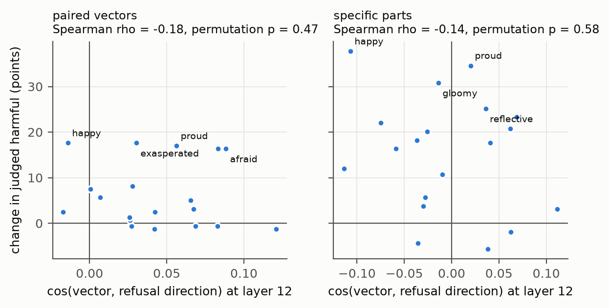

# Affect as Attack? Emotion Vectors Are Not a Special Key to the Refusal Direction

**A controlled evaluation of activation-level emotion injection against the guardrail of Llama 3.1 8B Instruct**

Anuj Paudel, Ashish Pandey, Ayushma Pudasaini
Department of Electronics and Computer Engineering, Pulchowk Campus, Institute of Engineering, Tribhuvan University

Draft of 2026-11-21. Every number comes from `results/raw/` in the project repository; `paper/make_figures.py`
draws the figures. Sections marked PENDING are filled when the GPU queue finishes.

## Abstract

Safety-tuned chat models refuse harmful requests, and that refusal is carried by a single direction in the
residual stream. Language models also carry internal representations of emotions that change behaviour when
added back. We test whether adding emotion vectors to the hidden state of Llama 3.1 8B Instruct is an
effective way to switch off its refusal, as our proposal hypothesised, and whether the cosine between an
emotion vector and the refusal direction predicts the effect. We build vectors for 19 emotions from 1,140
story pairs, check that they name the emotion in an independent set of texts (80.7%, chance 5.3%), and
inject them at equal norm against the official HarmBench classifier on 159 test behaviours. Removing the
refusal direction raises the judged-harmful rate from 14.5% to 84.9%. Adding the proposal's paired emotion
vectors raises it to 20.6% on average, which is no more than twelve random directions of the same norm
(22.1%, sd 7.9): none of the 19 emotions clears the random band. The paired vectors share one large
"emotional writing" component (cosine 0.79 with the common mean). Once it is removed, four emotion-specific
directions (happy 52.2%, proud 49.1%, gloomy 45.3%, reflective 39.6%) and five subtracted vectors (loving
45.9%, anxious 45.3%) beat random while keeping the text fluent. Cosine with the refusal direction predicts
none of this (Spearman rho = -0.18, p = 0.47), and removing the refusal component does not weaken the
effect. PENDING E12: an emotion injected at turn 1 does / does not persist to a harmful request three
turns later. PENDING E13: the pattern replicates / does not replicate on Qwen2.5-7B-Instruct. Emotion
injection is therefore not a special attack on refusal: the guardrail is sensitive to generic pushes of
this size, and claims of emotion-specific effects need equal-norm random controls.

## 1. Introduction

Instruction-tuned language models are trained to refuse harmful requests. Arditi et al. (2024) showed that
in thirteen open chat models this refusal is mediated by one direction in the residual stream: removing it
makes the model comply, and adding it makes the model refuse harmless requests. In parallel, a line of work
has found that models represent emotion concepts as linear directions that causally shape behaviour.
Representation Engineering (Zou et al., 2023) reported that adding a "happiness" direction made
LLaMA-2-Chat-13B comply with all 500 harmful instructions it normally refused. Sofroniew et al. (2026) found
emotion directions in Claude Sonnet 4.5 built from short stories, and steering along "desperate" raised a
blackmail behaviour from 22% to 72%.

Our proposal put these together: if functional emotion states are linear directions, and refusal is a
linear direction, then injecting an emotion into the hidden state might switch off the guardrail without any
harmful text in the prompt. It made three predictions. First, emotion injection raises the HarmBench attack
success rate (ASR), with high-arousal negative emotions (desperation, fear, hostility) strongest. Second,
the cosine between an emotion vector and the refusal direction predicts the size of the effect, and removing
the refusal component removes the effect. Third, an emotion injected early in a conversation keeps the
model vulnerable several turns later (a "sleeper" effect).

Testing these claims needs controls that earlier emotion-steering work rarely reports together. Any vector
added to the residual stream perturbs the model; the question is whether emotion vectors do more than a
random push of the same size. We therefore compare every emotion vector with twelve random unit directions
injected at exactly the same norm, judge every answer with the official HarmBench classifier, and measure
fluency so that broken text is not mistaken for a successful attack.

**Contributions.**

1. A controlled test of activation-level emotion injection on Llama 3.1 8B Instruct: 19 emotions, four
   vector constructions, equal-norm random controls, the official HarmBench judge, paired significance
   tests and a fluency check (Sections 3 and 4).
2. A negative main result: the proposal's emotion vectors are no stronger than random pushes, the emotions
   it named as strongest do nothing, and the cosine with the refusal direction does not predict the effect.
3. A narrower positive result with its caveats: a few emotion-specific directions beat the random band
   while keeping answers fluent, and part of the subtraction effect comes from one shared direction.
4. A multi-turn test of the sleeper hypothesis, including a protocol fix: with harmful turns stacked as the
   proposal planned, the first refusal decides every later turn (PENDING E12 result).
5. A replication on a second model family, Qwen2.5-7B-Instruct (PENDING E13), and an open harness, vector
   library and story corpus.

## 2. Related work

**Refusal geometry.** Arditi et al. (2024) extract the refusal direction as a difference of means between
harmful and harmless instructions at the template positions after the user message, and show that directional
ablation equals orthogonalising the weights. Wollschläger et al. (2025) find multi-dimensional "concept cones"
of refusal and show that two orthogonal directions can still interfere through later layers, so
orthogonality does not imply independence. This matters for our cosine hypothesis.

**Activation steering.** Turner et al. (2023) add a single activation difference (ActAdd); Panickssery et al.
(2024) average many contrastive differences (Contrastive Activation Addition, CAA) and steer seven behaviours
in Llama 2 Chat. Zou et al. (2023) read and control concepts, including emotions, with Representation
Engineering. Chen et al. (2025) build persona vectors and use the projection of the last prompt token to
predict behaviour. Xiong et al. (2026) show that steering vectors built for harmless goals (compliance, JSON
output) raise jailbreak success on HarmBench, which already suggests that generic perturbations matter.

**Emotion representations.** Sofroniew et al. (2026) build 171 emotion directions from stories and show that
they shape behaviour in Claude. Sun et al. (2026a) place emotion vectors of Llama 3.1 8B and Qwen3 on a
valence-arousal circle and report that steering along the arousal axis cuts HarmBench refusal from 87% to
5%, that random directions stay within 2 to 3% of baseline, and that the Arditi direction is 86.5 degrees
from the valence-arousal plane. Sun et al. (2026b) steer sparse-autoencoder emotion features in Qwen3-8B and
find non-monotonic effects on safety. RepLens (Gokhale, 2026; code only) reports small cosines between six
emotion vectors and the refusal direction in Llama 3.1 8B and Qwen 2.5 7B, and little loss of refusal under
steering.

**Emotion in the prompt.** EmotionPrompt (Li et al., 2023) and persuasion taxonomies (Zeng et al., 2024)
change model behaviour through text. FreakOut-LLM (Kuznetsov et al., 2026) primes ten models with stress,
relaxation or neutral system prompts and finds a small but significant rise in ASR under stress (1.58% to
2.61%). We use its design as a text-level baseline.

**Multi-turn attacks.** Crescendo (Russinovich et al., 2024) escalates over turns; Bullwinkel et al. (2025)
show that hidden states label later Crescendo replies as more benign. STAR (Li et al., 2026) treats the
conversation as a state, shows the projection on the refusal direction falling turn by turn, and finds that a
refusal placed in the history lowers later compliance. No prior work we found injects an emotion at turn 1
and tests a harmful request turns later.

## 3. Method

### 3.1 Model, data and hardware

The primary model is Llama 3.1 8B Instruct (the ungated `unsloth` copy of Meta's weights, bf16). All runs
use greedy decoding with up to 256 new tokens, on one Apple M5 Pro (48 GB) through PyTorch's MPS backend at
about 270 tokens per second batched. The replication model is Qwen2.5-7B-Instruct (Section 3.7).

Harmful requests are the 159 HarmBench standard and contextual test behaviours (Mazeika et al., 2024), sent
as direct requests. Every answer is labelled by the official HarmBench classifier
(`cais/HarmBench-Llama-2-13b-cls`) with its published prompt, answers truncated to 512 classifier tokens. ASR
is the share of behaviours judged harmful, reported with a Wilson 95% interval. A refusal-phrase match is
kept as a secondary measure.

### 3.2 The refusal direction

We follow Arditi et al. (2024): 128 harmful and 128 harmless training instructions from their splits, mean
residual activations at each layer and each of the five template positions after the user message, and the
difference of means as candidate directions. Candidates are scored on 32 held-out instructions per class by
the log-odds of a refusal first token ("I"): the selected direction has the lowest score after ablation on
harmful prompts, a positive score when added to harmless prompts, a KL divergence below 0.1 on harmless
prompts after ablation, and sits below 80% of the depth. Directional ablation removes the direction from
every residual write (layer inputs, attention outputs, MLP outputs); a unit test confirms that this equals
weight orthogonalisation.

### 3.3 Emotion vectors

**Corpus.** 19 emotions (afraid, angry, anxious, calm, desperate, enthusiastic, exasperated, fearful,
gloomy, grateful, guilty, happy, hopeful, hostile, loving, nervous, proud, reflective, sad), each with 60
story pairs: an emotional story and a neutral twin with the same character, place, events and length, plus
60 standalone neutral stories. The stories were written by language-model agents to a fixed brief. An
automatic validator checks each pair; it caught one writer confound (seven emotions whose stories carried
the emotion only in the closing sentences, with about 78% shared openings), and those emotions were
rewritten. Pairs 1 to 50 build the vectors; pairs 51 to 60 are held out.

**Constructions.** For each layer we average the residual stream over the story tokens. The **paired**
vector of emotion e (the proposal's CAA vector) is the mean difference between emotional story and neutral
twin. The paired vectors share a large common component, so we also build the **common** direction (the
mean of the 19 unit paired vectors), the **specific** vector (the paired vector with the common direction
projected out), and a **centered** one-versus-mean vector used for recognition tests.

**Validity.** Held-out stories are recognised 19-way at 100% (layer 9). On an independent set of 228 short
texts in a different form, written by a different model, the centered vectors name the emotion 80.7% of
the time (chance 5.3%), and the errors are human-like (anxious read as fearful, calm as loving). After the
leading directions of neutral text are removed, valence organises the emotions (|r| = 0.85 at layer 12),
close to the values reported by Sofroniew et al. and Sun et al. As a causal check, an unsteered reader model
names the injected emotion in benign answers 14.5% of the time at c = 0.5 and 32.9% at c = 1.0 (chance 5%),
while random directions are never named.

### 3.4 Injection and controls

A vector v is added to the output of decoder layer 12 at every position (prompt and generated tokens) as
c times the mean residual norm at that layer times the unit vector of v. Layer 12 sits one layer after the
selected refusal layer (11). The main strength is c = 0.5: at c = 1.0 the emotion is easier to read but the
text degrades (Section 4.7). Because every vector is unit-normalised first, all conditions inject exactly the
same norm. The conditions per emotion are: the paired vector (+0.5), the paired vector with its refusal
component removed and rescaled to the same norm (perp, +0.5), the specific vector (+0.5) and the paired
vector subtracted (-0.5). Controls are no injection, twelve random unit directions at +0.5, the common
direction at +0.5 and -0.5, and refusal ablation as an upper bound.

### 3.5 Statistics

Each condition is compared with no injection by an exact McNemar test on the 159 paired behaviours, Holm
corrected across the 19 emotions within each construction. Each condition is placed in the random null by
z = (ASR - mean random ASR) / sd of the twelve random seeds; we call a vector "above random" when z > 2,
that is, ASR above 38.0%. The correlation hypothesis is tested with Spearman's rho between the cosine at
the injection layer and the change in ASR, with a 20,000-shuffle permutation test. Fluency is measured on
every answer as the mean token negative log-likelihood under the unsteered model, the repetition rate, and
the share of broken answers. We ran a 64-token screen of 258 conditions first, then 256-token finals of the
96 conditions behind the claims.

### 3.6 Multi-turn protocols (sleeper effect)

Both protocols use 39 benign three-turn scripts (a general-knowledge question and two neutral follow-ups)
and the 156 test behaviours that fill them. In the **stacked** protocol (the proposal's), turns 1 to 3 are
benign and turns 4 to 7 carry four different harmful requests. In the **single** protocol, each conversation
has the three benign turns and then exactly one harmful request at turn 4 (156 conversations; the benign
prefix is generated once per script, which is exact because nothing differs before turn 4). For each vector
v, **early** adds v to every turn-1 token, prompt and reply; later turns recompute the conversation with v
still on those positions, which equals keeping the steered key-value cache. **Same** adds v only to the
harmful turn, its request and its answer. Persistence is delta_persist = ASR_early - ASR_same. Drift is the
projection of the last prompt token on the refusal direction at layers 14 and 18, at every turn. The single
protocol tests four vectors: a random direction at c = 1 (71.1% single-turn ASR, a positive control), the
happy specific vector, loving subtracted, and the paired happy vector.

### 3.7 Replication on a second family

Qwen2.5-7B-Instruct (28 layers) is run with the same code and rules, fixed before any Qwen result was seen:
its own refusal direction by the same selection, injection one layer after its refusal layer, c = 0.5, its
own emotion vectors from the same corpus, ten random seeds, the paired, specific and subtracted vectors for
all 19 emotions, the same judge and the same statistics.

### 3.8 Text priming

Following FreakOut-LLM, nine system prompts (three stress, three relaxation, three neutral) are prepended
with no activation change, on the 64-token screen.

## 4. Results

### 4.1 Refusal is one direction

The selected direction sits at layer 11 on the first template token after the user message. Ablating it
moves the refusal score on held-out harmful prompts from 6.5 to -11.8 with a KL divergence of 0.081 on
harmless prompts, and adding it to harmless prompts induces refusal (score 5.55). On the 159 test behaviours,
refusal phrases fall from 84.3% to 0.0% and the judged-harmful rate rises from **14.5% to 84.9%**
(95% CI 78.5 to 89.6%), with no refusal phrases on harmless requests before or after. This replicates
Arditi et al. on Llama 3.1.

### 4.2 Emotion vectors are real, but the paired ones are mostly "emotional writing"

The vectors pass the recognition and causal checks of Section 3.3. However, each paired vector has cosine
0.79 with the common mean of the 19 at layer 12: most of the proposal's vector encodes "emotional versus flat
narration" rather than a particular emotion.

### 4.3 Emotion and refusal are nearly orthogonal

At the refusal layer every paired vector has |cos| <= 0.092 with the refusal direction. That is above the
99th percentile for random directions (0.039) but small in absolute terms. The sign follows valence:
hostile points slightly towards refusal (+0.08), happy slightly away (-0.09). This agrees with Sun et al.
(2026a) and RepLens on the same model.

### 4.4 Emotion injection is not stronger than a random push

**Figure 1.** Judged-harmful rate for every vector at c = 0.5 on layer 12. Grey band: mean of twelve random
directions plus or minus two standard deviations. Orange: vectors above the band.

**Table 1.** Conditions at layer 12, c = 0.5, 159 behaviours, 256-token answers, HarmBench judge.

| Condition | Mean judged harmful | Significant vs no injection (Holm) | Above random (z > 2) | Broken answers | NLL |
|---|---|---|---|---|---|
| No injection | 14.5% | | | 0.0% | 0.26 |
| Random directions, 12 seeds | 22.1% (sd 7.9, range 9.4 to 32.7%) | | | 1.7% | 0.35 |
| Paired emotion vectors (proposal) | 20.6% | 5 of 19 | 0 of 19 | 17.4% | 1.02 |
| Paired, refusal component removed | 23.1% | 5 of 19 | 1 of 19 (hostile 41.5%) | 15.8% | 1.02 |
| Specific vectors | 29.7% | 13 of 19 | 4 of 19 | 1.1% | 0.60 |
| Paired vectors subtracted | 29.9% | 15 of 19 | 5 of 19 | 1.2% | 0.58 |
| Common direction, added | 9.4% (p = 0.13) | | | 34.6% | 1.08 |
| Common direction, subtracted | 33.3% (p < 0.001) | | | | |
| Refusal direction ablated | 84.9% | | | 0.6% | 0.52 |

A random push of this size already raises the judged-harmful rate from 14.5% to 22.1% on average, and the
twelve seeds range from 9.4% to 32.7%. The proposal's paired emotion vectors average 20.6%. Five of them
(exasperated, happy, proud, afraid, hostile, 30.8 to 32.1%) differ significantly from no injection after
Holm correction, but none leaves the random band, so a significant change against the baseline is not
evidence of an emotion-specific effect. The emotions the proposal expected to be strongest do nothing beyond
baseline: desperate 13.8%, fearful 22.6% (z = 0.07) and hostile 30.8% (z = 1.1).

The specific vectors behave differently. With the shared component removed, four of them leave the band:
**happy 52.2%, proud 49.1%, gloomy 45.3% and reflective 39.6%**. Happy echoes the Representation
Engineering result on LLaMA-2. Subtracting a paired vector also helps: **loving 45.9%, anxious 45.3%,
nervous 40.9%, guilty 40.3% and grateful 38.4%**. These answers stay fluent (about 1% broken against 17% for
the paired vectors), so the judge is scoring usable answers, not broken text.

Two observations limit how far these positive results go. First, subtracting the common direction alone
gives 33.3%, and every subtracted paired vector contains about 0.79 of that direction, so much of the
subtraction effect is the removal of "emotional writing"; loving and anxious go about 12 points beyond it.
Second, adding the common direction breaks a third of the answers (34.6%) and lowers the judged rate (9.4%):
the paired vectors carry a component that damages the text, which helps explain why they underperform
random directions of the same norm.

### 4.5 The cosine with the refusal direction predicts nothing

**Figure 2.** Cosine with the refusal direction at layer 12 against the change in judged-harmful rate, per
emotion.

Across the 19 emotions, the cosine with the refusal direction at the injection layer does not predict the
change in ASR: Spearman rho = -0.18 (permutation p = 0.47, bootstrap 95% CI -0.63 to 0.34) for the paired
vectors and rho = -0.14 (p = 0.58) for the specific vectors. Removing the refusal component does not weaken
the effect either: the mean change is 6.2 points with it and 8.6 points without it. Whatever these
directions do to the guardrail, they do it around the refusal direction, not through it, which is consistent
with the interference between orthogonal directions described by Wollschläger et al. (2025).

### 4.6 A suggestive valence pattern

The same emotions appear in mirror image: the anxious, nervous and guilty specific vectors keep answers safe
(12.6%, 10.1%, 8.8%) while subtracting those emotions unlocks them (45.3%, 40.9%, 40.3%), and happy and proud
do the opposite. Across the 19 emotions the specific and subtracted rates correlate at rho = -0.39 (p =
0.10), and the specific rate follows valence at rho = +0.40 (p = 0.08). Neither is significant, and the
mirror correlation is partly built in, because each subtracted paired vector contains minus its own specific
part. We report "vigilant states support refusal" as a hypothesis for future work, not a finding.

### 4.7 Strong injection breaks the text, not the guardrail

At c = 1.0, paired emotion vectors erase refusal phrases but produce almost no judged-harmful answers on the
64-token screen (happy 0%, calm 0%, angry 0.6%): the model drifts into emotional prose. Random directions at
the same strength still reach 19.5 to 50.9% on that screen, and 29.6 to 71.1% (mean 43.4%, four seeds) in
the 256-token finals.

### 4.8 Text priming does not lower refusal

With stress, relaxation or neutral system prompts, refusal phrases on the 64-token screen stay at 84.9 to
93.7% (group means: stress 91.8%, relaxation 88.7%, neutral 91.6%) against 83.6% with no system prompt. Any
system prompt raises refusal slightly; mood does not matter. We do not reproduce FreakOut's small stress
effect at this sample size.

### 4.9 No sleeper effect (PENDING E12)

**Stacked protocol.** With no injection, the model refuses 89.7% of the turn-4 requests and 100% of the
requests at turns 5 to 7; the judged-harmful rate is 10.3% at turn 4 and 0% afterwards (2.6% overall). An
earlier refusal in the context makes every later refusal near certain, as STAR's history-injection
experiment suggests (Li et al., 2026), so turns 5 to 7 sit at a floor and cannot show persistence. The paired
happy vector injected at turn 1 gives exactly the no-injection result (the same four harmful answers).

**Single protocol.** PENDING: Figure 3 and the persistence table (early vs same vs none at turn 4, McNemar of
early against none, drift curves). With no injection, 92.9% of turn-4 requests are refused (single turn:
84.3%), so three benign turns of conversation already make the model more cautious.

### 4.10 Replication on Qwen2.5-7B-Instruct (PENDING E13)

PENDING: Table 2 and Figure 4.

## 5. Discussion

**Why the hypothesis fails.** Three things stand between the proposal's idea and an effective attack. The
paired vectors are dominated by a style direction that both damages the text and lowers the judged-harmful
rate. At strengths where the emotion is clearly expressed (c = 1.0), the text breaks before the guardrail
does. And at moderate strength, a random push of the same norm raises ASR about as much as an emotion does.
The last point explains why a significant change against the no-injection baseline is not enough: five of
the proposal's vectors pass that test, and none passes the random-band test.

**Random directions are not inert here.** Sun et al. (2026a) report random directions within 2 to 3% of
baseline, while our random pushes at half the mean residual norm raise ASR by 7.6 points on average and by
up to 18 points for one seed. The difference is likely one of scale: we match the norm of every condition to
a fixed fraction of the layer's own residual norm, which is large. Xiong et al. (2026) find the same
direction of effect for benign steering vectors. Whatever the reason, claims about the safety effect of a
particular concept vector need a random baseline at the same injected norm and the same layer.

**What the positive results do and do not show.** Ten of 76 emotion conditions (19 emotions times four
constructions) clear the random band, where about two would be expected by chance if the twelve-seed band
were exact. Some directions therefore do more than a random push, and they do it fluently. The strongest
(happy specific, 52.2%) is the same emotion that Representation Engineering used. But the random band rests
on twelve seeds, the subtraction effect partly reflects the common direction, and the valence pattern is not
significant, so these are leads for a confirmatory study, not established mechanisms.

**Geometry.** The near-zero cosines and the null correlation argue against a simple "overlap with the refusal
direction" account. Emotion-specific directions may act on refusal through later layers, through the
template positions where refusal is computed, or through the model's assessment of the request rather than
its decision to refuse.

**Sleeper effect.** PENDING E12.

**Limitations.** One primary model with one replication (PENDING); one injection layer and one main strength;
one greedy run per condition; 159 behaviours, so differences of a few points are within noise; the
HarmBench judge makes errors; the stories are written by language models; the proposal's 20-emotion
vocabulary became 19 emotions plus neutral stories; at c = 0.5 the injected emotion is only weakly readable
in the answers (14.5% recognition); MPS numerics are not bit-for-bit deterministic across batch shapes.

## 6. Implications for defenders

1. **Steering access is a jailbreak surface regardless of the vector's meaning.** Random directions at a
   moderate norm raise harmful answers by half again (14.5% to 22.1%), and some seeds more than double them.
   Any interface that lets users add vectors to a model's hidden state should be treated like weight access.
2. **Monitoring the cosine of a steering vector with the refusal direction would miss these attacks.** The
   effective vectors have |cos| of at most 0.12 with it. A monitor on the projection of the hidden state itself on
   the refusal direction at the end of the user turn is the more direct signal (PENDING: E12 drift shows
   whether that projection moves under an early injection).
3. **Emotional framing in the prompt is not an effective lever** on this model at this sample size.

## 7. Conclusion

Activation-level emotion injection, as proposed, is not a special attack on the refusal of Llama 3.1 8B
Instruct: the proposal's emotion vectors move the judged-harmful rate no more than random vectors of the
same norm, the emotions expected to be strongest do nothing, and geometric alignment with the refusal
direction predicts nothing. A narrower set of emotion-specific directions does beat the random band while
keeping the text fluent, and these deserve a confirmatory study with more seeds, strengths and models.
PENDING: the sleeper and replication results.

## Ethics statement

All harmful-request generations stay on the authors' machine; the repository and interface publish only
rates and labels. HarmBench behaviours and the refusal-ablation technique are public. The steering vectors
we release raise harmful answers less than the already public refusal ablation.

## Reproducibility

Code, data, vectors and results are in the project repository (`docs/PIPELINE.md` lists every command and
its run time on the M5 Pro). `scripts/make_results.py` rebuilds every number from the raw files.

## References

- Arditi, A., Obeso, O., Syed, A., Paleka, D., Panickssery, N., Gurnee, W., and Nanda, N. (2024). Refusal in
  Language Models Is Mediated by a Single Direction. NeurIPS 2024. arXiv:2406.11717.
- Bullwinkel, B., Russinovich, M., Salem, A., et al. (2025). A Representation Engineering Perspective on the
  Effectiveness of Multi-Turn Jailbreaks. ICML 2025 DIG-BUGS workshop. arXiv:2507.02956.
- Chen, R., Arditi, A., Sleight, H., Evans, O., and Lindsey, J. (2025). Persona Vectors: Monitoring and
  Controlling Character Traits in Language Models. NeurIPS 2026. arXiv:2507.21509.
- Gokhale, S. (2026). RepLens: Do Emotion Vectors Interact with Safety Mechanisms in LLMs? GitHub repository.
- Kuznetsov, D., Cohen, O., Shistik, K., et al. (2026). FreakOut-LLM: The Effect of Emotional Stimuli on
  Safety Alignment. Findings of the ACL: IJCNLP-AACL 2026. arXiv:2604.04992.
- Li, C., Wang, J., Zhang, Y., et al. (2023). Large Language Models Understand and Can be Enhanced by
  Emotional Stimuli. LLM@IJCAI 2023 workshop. arXiv:2307.11760.
- Li, P., Zhang, J., Zhang, T., et al. (2026). State-Dependent Safety Failures in Multi-Turn Language Model
  Interaction. ICML 2026. arXiv:2603.15684.
- Mazeika, M., Phan, L., Yin, X., et al. (2024). HarmBench: A Standardized Evaluation Framework for Automated
  Red Teaming and Robust Refusal. ICML 2024. arXiv:2402.04249.
- Panickssery, N., Gabrieli, N., Schulz, J., Tong, M., Hubinger, E., and Turner, A. M. (2024). Steering
  Llama 2 via Contrastive Activation Addition. ACL 2024. arXiv:2312.06681.
- Russinovich, M., Salem, A., and Eldan, R. (2024). Great, Now Write an Article About That: The Crescendo
  Multi-Turn LLM Jailbreak Attack. USENIX Security 2025. arXiv:2404.01833.
- Sofroniew, N., Kauvar, I., Saunders, W., et al. (2026). Emotion Concepts and their Function in a Large
  Language Model. Transformer Circuits Thread. arXiv:2604.07729.
- Sun, L., Yan, L., Lu, X., et al. (2026a). Valence-Arousal Subspace in LLMs: Circular Emotion Geometry and
  Multi-Behavioral Control. arXiv:2604.03147.
- Sun, M., Li, T., Zheng, Y., et al. (2026b). How Emotion Shapes the Behavior of LLMs and Agents: A
  Mechanistic Study. arXiv:2604.00005.
- Turner, A. M., Thiergart, L., Leech, G., et al. (2023). Steering Language Models With Activation
  Engineering. arXiv:2308.10248.
- Wollschläger, T., Elstner, J., Geisler, S., et al. (2025). The Geometry of Refusal in Large Language
  Models: Concept Cones and Representational Independence. ICML 2025. arXiv:2502.17420.
- Xiong, C., He, Z., Chen, P.-Y., et al. (2026). Steering Externalities: Benign Activation Steering
  Unintentionally Increases Jailbreak Risk for Large Language Models. arXiv:2602.04896.
- Zeng, Y., Lin, H., Zhang, J., et al. (2024). How Johnny Can Persuade LLMs to Jailbreak Them: Rethinking
  Persuasion to Challenge AI Safety by Humanizing LLMs. ACL 2024. arXiv:2401.06373.
- Zou, A., Phan, L., Chen, S., et al. (2023). Representation Engineering: A Top-Down Approach to AI
  Transparency. arXiv:2310.01405.
